# Tamagotchi, Digimon und Pocket Pikachu im Browser, mit Care-Bot

Vierzehn Taschentiere aus den Jahren 1996 bis 1998 – zehn Tamagotchis, drei Digimon und der
Pocket Pikachu – laufen hier als Originalprogramme auf nachgebauten Prozessoren auf einem Server
und werden im Browser angezeigt, beliebig viele Tiere nebeneinander, jedes in seinem Tab. Ein
Care-Bot drückt die Tasten, wenn ein Tier etwas braucht, und kann gezielt einen bestimmten
Charakter großziehen.

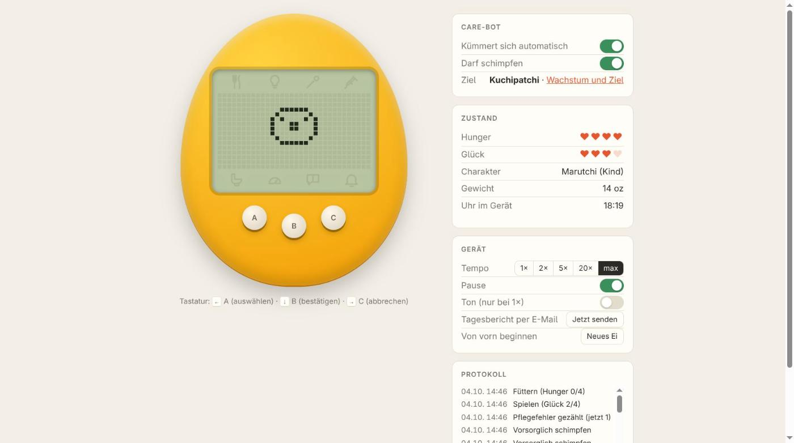

## Warum

Die Geräte von damals würden vermutlich noch Jahrzehnte funktionieren – und trotzdem liegen die
meisten seit Langem ungenutzt in einer Schublade. Ich wollte den kleinen digitalen Kreaturen
einen Ort geben, an dem sie wirklich leben: Hier schlüpfen sie, wachsen, schlafen und werden
jeden Tag versorgt. Dass sich dabei kein Kind um sie kümmert, sondern nur ein Programm, stört sie
hoffentlich nicht. Alle, die ich als Kind so mochte, sollen ein schönes Leben haben.

Ich selbst war in der Pflege übrigens nie besonders gut. Nur mit Pikachu bin ich damals wirklich
viel gelaufen. Zuschauen kann man ihnen auf [tamagotchi.mahok.de](https://tamagotchi.mahok.de).

## Technik

Die Emulation übernimmt [TamaLIB](https://github.com/jcrona/tamalib) von Jean-Christophe Rona;
nur der Pocket Pikachu hat einen anderen Prozessor und dafür einen eigenen Kern nach dem Vorbild
von [BrickEmuPy](https://github.com/azya52/BrickEmuPy), und das Tamagotchi-Spiel für den Game Boy
läuft auf [Peanut-GB](https://github.com/deltabeard/Peanut-GB) von Mahyar Koshkouei. Darum herum liegen eine dünne C-Hülle,
ein Python-Server ohne weitere Abhängigkeiten und ein paar HTML-Seiten.

## Die ROM gehört nicht dazu

Die ROMs sind urheberrechtlich geschützt und liegen nicht in diesem Repository. Jedes Modell
braucht seine eigene:

| Modell | Datei | Größe | SHA-1 | CRC32 |
|---|---|---|---|---|
| Tamagotchi P1 | `tama.b` aus dem MAME-Romset `tama` | 12 288 Bytes | `4b4979cf92dc9d2fb6d7295a38f209f3da144f72` | `5c864cb1` |
| Tamagotchi P1 Japan | `TamagotchiP1J.bin` (Sammlung zu BrickEmuPy) | 12 288 Bytes | `15763f806c9c792f6a6458538dbd932a3c6668a3` | `15647a14` |
| Tamagotchi P2 | `tamag2.bin` aus dem MAME-Romset `tamag2` | 12 288 Bytes | `09e5101b37636a314fc599d5d69b4846721b3c88` | `9f97539e` |
| Tamagotchi Angel | `tamaang.bin` aus dem MAME-Romset `tamaang` | 16 384 Bytes | `f5899bb7717756ac581451cf16cf97d909961c5c` | `87bcb59f` |
| Tamagotchi Morino | `TamagotchiMorino.bin` (Sammlung zu BrickEmuPy) | 16 384 Bytes | `4b578ea5dd328fd49fc7a664abeca79e35d573b2` | `647ea772` |
| Tamagotchi Umino | `TamagotchiUmino.bin` (Sammlung zu BrickEmuPy) | 16 384 Bytes | `69d916819f8f4aa4be9194e6c78f099bf8199f37` | `baae4199` |
| Tamagotchi Mothra | `tamamot.bin` aus dem MAME-Romset `tamamot` | 16 384 Bytes | `74c1f6761724b7cbda8bca3113db78586b786d2d` | `85e4bee9` |
| Tamagotchi Genjintch | `TamagotchiGenjintch.bin` (Sammlung zu BrickEmuPy) | 16 384 Bytes | `e317eac80c3360b766b92a2da253bda32fd50273` | `bbf6b4fe` |
| Tamagotchi Tamaotch | `TamagotchiTamaotch.bin` (Sammlung zu BrickEmuPy) | 16 384 Bytes | `d4ea15fa2abb16bd844c79e3b095a6f6cf21a98f` | `a491fb55` |
| Tamagotchi Yasashii | `TamagotchiYasashii.bin` (Sammlung zu BrickEmuPy) | 16 384 Bytes | `dc713b7eb4cbc5d9e921fe3bd97662c72bc68534` | `0549477a` |
| Digimon V1 | `digimon.bin` aus dem MAME-Romset `digimon` | 16 384 Bytes | `1dde9b0aa81c8f4a1e22d3a79d4743833fc6cba7` | `08ffac1b` |
| Digimon V2 | `digimonv2.bin` aus dem MAME-Romset `digimonv2` | 16 384 Bytes | `ab860ca9f31f478532122cb9d20f59964a080a27` | `19a9e54e` |
| Digimon V3 | `digimonv3.bin` aus dem MAME-Romset `digimonv3` | 16 384 Bytes | `0acd50e623e20d857e13bae150ac03405896cf2b` | `3000cf30` |
| Pocket Pikachu | `PocketPikachu.bin` (Sammlung zu BrickEmuPy) | 20 480 Bytes | `b96e3eb9f9c973fd9e27dfb01591f4cde4d91f99` | `20c481e4` |
| Tamagotchi (Game Boy) | `Tamagotchi (USA, Europe) (SGB Enhanced).gb`, vom eigenen Modul | 524 288 Bytes | `7368ec190bed39429812a26e18b2d3e153cf4e81` | `dbf1bd20` |

Ist beim Start keine ROM da, zeigt der Server statt des Tamagotchis die Seite „Optionen“ und
fragt danach: Man lädt die Datei (oder das ZIP des Romsets) im Browser hoch oder nennt den Pfad,
unter dem sie auf dem Server liegt. Angenommen wird sie nur, wenn die Prüfsumme passt.
Gespeichert wird sie im Ordner `roms/` neben den Spielständen. Wer ROMs selbst hinlegen will:
dorthin, als `tama.b` neben den Spielstand, nach `tama/tama.b`, oder mit `--rom` eine Datei oder
einen ganzen Ordner angeben (mehrfach möglich).

## Mehrere Tiere

Oben auf der Seite steht für jedes Tier ein Tab mit dem Gehäuse seines Modells als kleinem
Bild, „+“ legt ein neues an (das Gehäuse des Modells anklicken, Name vergeben), auch mehrere vom
selben Modell.
Jedes Tier hat seinen eigenen Care-Bot, sein Ziel, sein Tempo und seinen Spielstand.
„Tier entfernen“ schließt den Tab; der Spielstand wird dabei
nicht gelöscht, sondern nach `deleted/` verschoben.

Jedes Tier läuft in einem eigenen Prozess (TamaLIB hält die ganze Maschine in globalen
Variablen, in einen Prozess passt also nur eines). In Echtzeit braucht ein Tier etwa 1 % eines
Prozessorkerns und 25 MB.

Neben dem Spielstand des ersten Tiers (`tama_state.json`) liegen `pets.json` mit der Liste der
Tiere, `pets/` mit den weiteren Spielständen, `settings.json` und `history.sqlite`. Wer von der Fassung mit nur
einem Tier kommt, findet es als ersten Tab wieder.

### Verlauf

Was die Tiere erleben, bleibt in einer SQLite-Datei (`history.sqlite`, `history.py`) stehen,
auch wenn ein Tab entfernt wird: jedes Leben mit Tab, Name, Ziel, Ende und den Figuren, die es
durchlaufen hat (mit Zeitpunkt und den Werten in dem Moment), und jede Zeile der Protokolle.
Beim Game Boy zählt jeder der drei Plätze für sich. Die Seite `/verlauf` (Link „Verlauf“ im
Tab) zeigt die Sammlung der Figuren, die es je Modell schon gab, die Liste der Leben und das
Protokoll eines Tabs zum Zurückblättern. Die Leben aus der früheren Chronik werden beim ersten
Start übernommen; sie haben ihre Figuren, aber keine Zeiten dazu.


## Starten

```bash
python3 server.py            # baut libtama.so bei Bedarf, dann http://127.0.0.1:8137
```

Benötigt `gcc`, `make` und `python3`. Strg+C beendet und speichert den Spielstand in
`tama_state.json`. Mit Docker: `docker compose up -d --build`; Spielstand, ROM und
Einstellungen liegen dann im Volume unter `/data`. Die Compose-Datei veröffentlicht
keinen Port und erwartet ein externes Netz `httpd` für einen Reverse-Proxy; das ist an die
eigene Umgebung anzupassen. Die Oberfläche hat keine Anmeldung und gehört nicht ungeschützt ins
Internet.

Das Tier lebt im Server-Prozess und läuft weiter, wenn kein Browser offen ist. Das Tempo lässt
sich bis etwa 2600-fach hochdrehen.

Optional schickt der Server abends einen Tagesbericht per E-Mail. Der Mailserver wird auf der
Seite „Optionen“ (`/settings`) eingetragen und in `settings.json` neben dem Spielstand
gespeichert, das Passwort unverschlüsselt. Umgebungsvariablen (`.env.example`) dienen als
Vorgabe. Bei mehreren Tieren lässt sich dort statt einer Mail je Tier eine Sammel-Mail wählen:
Sie geht raus, sobald das letzte Tier eingeschlafen ist, spätestens zur eingestellten Uhrzeit;
wer dann noch wach ist, steht mit seinem Stand von diesem Moment darin.

## Die Seite für alle

Mit `--public-port 8138` (oder `PUBLIC_PORT`) öffnet der Server einen zweiten Port, auf dem es
nur etwas zu sehen gibt: die Tiere in Tabs, live, dazu was das Gerät ist, was der Bot dort tut,
sein Ziel und die Leben, die es bisher gab. Unter dem Gerät steht ein Link zu einer Seite, die
mehr darüber weiß (`models.WIKI`).
Dieser Port kennt keinen einzigen Befehl – kein Tastendruck, keine Einstellung, kein Protokoll
(darin steht die Mail-Adresse) – und kann deshalb ohne Anmeldung unter einem eigenen Namen im
Netz stehen. Das Einzige, was ein Zuschauer auslöst: Verdeckt ein Bildschirmschoner das Tier
(Morino), nimmt der Server ihn weg. Mehr als 60 Zuschauer gleichzeitig weist er ab.

Steht in `PUBLIC_URL` die Adresse, unter der die Seite erreichbar ist, bekommt sie die Angaben
für die Vorschau eines geteilten Links (mit `web/vorschau.png`), eine `sitemap.xml` und den
Verweis darauf in `robots.txt`. Was die Geräte sind, steht fest im HTML und ist damit auch für
Suchmaschinen lesbar; das Livebild und die Liste der Tiere sind für sie gesperrt.

## Der Care-Bot

Der Bot liest Hunger, Glück, Häufchen und Krankheit aus dem RAM und dem Display und bedient dann
das Menü wie ein Mensch: A wählt das Icon, B bestätigt, C bricht ab. Er stellt außerdem die Uhr
des Geräts nach der Systemzeit.

Wer selbst eine Taste drückt oder ein Menü-Icon im Display anklickt (der Server läuft dann mit A
dorthin), hat das Gerät für sich: Der Bot bricht ab, was er gerade tut, und macht erst 60 Sekunden
nach der letzten Eingabe weiter.

Auf der Unterseite `/bot` lässt sich ein Ziel wählen. Der Bot macht dann genau die Fehler, die
für diesen Charakter nötig sind, und pflegt sonst fehlerfrei.

Am Ende eines Lebens bleibt das Gerät auf seinem letzten Bild stehen, bis jemand A und C zusammen
drückt: Dann erscheint ein neues Ei, die Uhr läuft weiter, und es schlüpft nach fünf Minuten von
selbst. Mit dem Schalter „Nach dem Ende neu beginnen“ (aus, solange man ihn nicht einschaltet)
macht das der Bot und zieht das nächste Tier mit demselben Ziel groß. Die ROM nimmt den
Doppeldruck nicht jedes Mal an; der Bot wiederholt ihn, bis das Ei da ist. Mit dem Schalter
„Mit zufälliger End-Evolution weitermachen“ darunter lost er für jedes neue Leben ein anderes
Ziel aus: nie das letzte Ziel und nie das, was das letzte Tier tatsächlich geworden ist. Ein
Programm über mehrere Leben (Lucky Unchi-Kun, die Zwillinge der Mothra) lässt er dabei in Ruhe.

Der „Zeitumkehrer“ vertauscht Tag und Nacht eines Tiers: Der Bot stellt die Uhr im Gerät dann
zwölf Stunden versetzt, es schläft tagsüber und ist nachts wach. Der Schalter gilt ab dem
nächsten Ei, damit ein laufendes Leben keinen halben Tag überspringt.

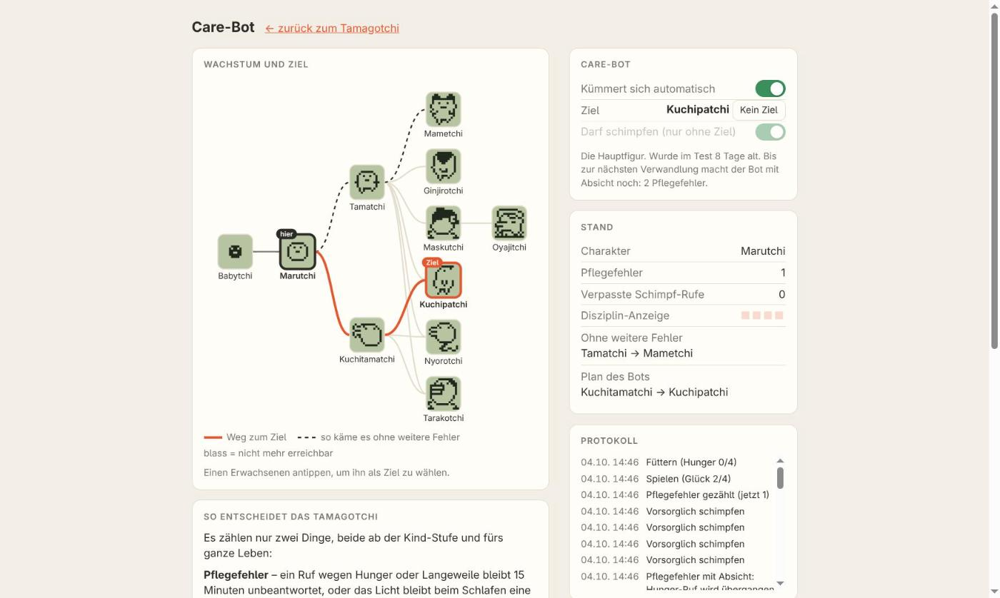

## Was den Charakter bestimmt

Die ROM zählt zwei Dinge, beide ab der Kind-Stufe, beide nur aufwärts bis 15 und für das ganze
Leben:

- **Pflegefehler** (RAM `0x42`): Ein Ruf wegen leerem Hunger oder leerem Glück bleibt etwa
  15 Minuten unbeantwortet, oder das Licht bleibt beim Schlafen 65 Minuten an.
- **Verpasste Schimpf-Rufe** (RAM `0x51`): Das Tier ruft, obwohl nichts fehlt, und wird etwa
  15 Minuten lang nicht geschimpft.

Die Disziplin-Anzeige im Status-Bild (RAM `0x43`) geht in die Entscheidung nicht ein.

| Verwandlung | Pflegefehler | verpasste Schimpf-Rufe | wird zu |
|---|---|---|---|
| Marutchi (Kind) | 0–2 | egal | Tamatchi |
| | ab 3 | egal | Kuchitamatchi |
| Tamatchi | 0–2 | 0 | Mametchi |
| | 0–2 | 1 | Ginjirotchi |
| | 0–2 | ab 2 | Maskutchi |
| | ab 3 | 0–1 | Kuchipatchi |
| | ab 3 | 2–3 | Nyorotchi |
| | ab 3 | ab 4 | Tarakotchi |
| Kuchitamatchi | egal | 0–1 | Kuchipatchi |
| | egal | 2 | Nyorotchi |
| | egal | ab 3 | Tarakotchi |

Hat schon das Kind drei oder mehr Schimpf-Rufe verpasst, entsteht eine zweite Art Teenager mit
anderen Grenzen (RAM `0x50`):

| Verwandlung | Pflegefehler | verpasste Schimpf-Rufe | wird zu |
|---|---|---|---|
| Tamatchi, zweite Art | 0–3 | ab 2 | Maskutchi, vier Tage später Oyajitchi |
| | ab 4 | bis 7 | Nyorotchi |
| | ab 4 | ab 8 | Tarakotchi |
| Kuchitamatchi, zweite Art | egal | bis 5 | Nyorotchi |
| | egal | ab 6 | Tarakotchi |

Die Geheimfigur Oyajitchi entsteht nur aus diesem Maskutchi. Ob danach geschimpft wird, ändert
daran nichts.

Diese Tabellen stammen nicht aus dem Netz, sondern aus der ROM: Kurz vor jeder Verwandlung
wurden beide Zähler im emulierten RAM auf alle 16 × 16 Kombinationen gesetzt und das Ergebnis
ausgelesen. Die Skripte dazu liegen in [`lab/`](lab/). Getestet sind nur diese drei ROM-Dumps;
andere Fassungen und die Neuauflagen können anders rechnen.

### Tamagotchi P1 Japan

Die japanische Ausgabe ergab dieselben Tabellen und hat dasselbe Spiel. Anders ist nur das Ende:
statt des Engels erscheint ein Grabstein.

### Tamagotchi Morino

Das Morino (Mori de Hakken! Tamagotch, das mit den Käfern) ist dieselbe Maschine wie die anderen:
Uhr, Hunger, Glück, Gewicht, Häufchen und Figur liegen in denselben RAM-Zellen. Anders ist fast
alles, was über das Wachstum entscheidet:

- **Zwei Eier:** Nach dem Uhrstellen wartet das Gerät auf eine Wahl. A oder C wechselt zwischen
  dem weißen Ei (Babymotchi, zwölf mögliche Erwachsene) und dem gefleckten (Imotchi, wird immer
  Kabutotchi), B zeigt die Uhr, ein weiteres B beginnt. Der Bot nimmt das weiße, außer das Ziel
  heißt Kabutotchi.
- **Keine Pflegefehler, keine Krankheit:** Es stirbt nur an Hunger, an Verletzungen oder im Kokon.
- **Fressfeinde:** Zur vollen Stunde kommt ab und zu ein Fuß oder ein Frosch. Das fünfte Icon
  leuchtet dann; es lässt sich sonst nicht anwählen. Eine Taste zeigt den Angreifer, Klopfen
  vertreibt ihn (zwei Glücksherzen). Sonst ist das Tier verletzt und braucht Medizin; ein zweiter
  Treffer im verletzten Zustand tötet es.
- **Spiel:** Unter einem von vier Hüten liegt ein Blatt, viermal hintereinander. RAM `0x80` verrät
  den Hut (dieser und der nächste gewinnen), der Bot trifft deshalb immer. Jedes Spiel kostet 1 mg.
- **Kokon:** Imotchi wird alle zwölf wachen Stunden gewogen und spinnt ab 40 mg einen Kokon. Dessen
  Art hängt an der versteckten Freundschaft (+2 je Spiel, −1 je verlorenem Glücksherz), der
  Erwachsene an der Temperatur am Ende der 24 Stunden. Der Bot steuert Gewicht, Freundschaft und
  Temperatur auf das gewählte Ziel hin; die Regeltabelle steht auf `/bot`.

| Kokon | entsteht bei | Temperatur am Ende | wird zu |
|---|---|---|---|
| A | 1. oder 2. Wiegen, Freundschaft ab 10 | 1–6 | Tentotchi |
| | | 7–9 | wieder Imotchi |
| | | 10–14 | Koganetchi (Twinaritchi, wenn die Süße durch 4 geteilt den Rest 3 lässt) |
| B | 1. oder 2. Wiegen mit Freundschaft 7–9, 3. Wiegen ab 7 | 1–7 | Minotchi |
| | | 8–14 | Chobitamatchi |
| C | 1. bis 3. Wiegen, Freundschaft bis 6 | 1–7 | Gejitchi |
| | | 8–14 | Mushibatchi |
| D | 4. Wiegen, egal wie schwer | 4–12 | Funkorogatchi |
| | | 1–3, 13–14 | Minotchi |
| gefleckt | geflecktes Ei, ab 40 mg | 1–14 | Kabutotchi |

Bei Temperatur 0 oder 15 stirbt der Kokon. Helmetchi schlüpft aus Kokon D, wenn die Imotchi vorher
schon einmal aus Kokon A zurückgekommen ist. Die Temperatur ändert sich etwa alle zweieinhalb
Stunden um 1 oder 2; für das schmale Fenster 7–9 kann der letzte Schritt danebengehen, Helmetchi
gelingt deshalb nicht in jedem Anlauf.

### Tamagotchi Umino

Das Umino (Umi de Hakken! Tamagotch, außerhalb Japans Tamagotchi Ocean) ist ein eigenes Programm:
Keine RAM-Zelle liegt dort, wo die anderen sie haben, deshalb hat es einen eigenen Bot
(`carebot_umino.py`). Es gilt als das schwerste der Reihe, und das liegt an vier Dingen:

- **Wasser statt Häufchen:** Etwa alle zwei Stunden kommt ein Totenkopf auf der Statusseite dazu,
  bei vier ist der Bildschirm schwarz. Jedes Wasserwechseln nimmt einen weg.
- **Fressfeind:** Ein Eisbär legt sich neben das dösende Tier. Eine Taste weckt es und er geht;
  sonst ist es verletzt und braucht Medizin. Der Bot drückt A. Die Rufbox täte es auch, zählt
  dabei aber als Schimpfen.
- **Krake:** In etwa jedem zwölften Spiel bricht ein Krake herein, schwärzt das Wasser und nimmt
  alle Glücksherzen. Dagegen hilft nichts.
- **Krankheit:** Jeder Snack erhöht einen versteckten Zähler um 2 bis 6, nach 255 beginnt er
  wieder bei 0. Alle zweieinhalb Stunden entscheidet sein Stand, ob das Tier krank wird; nahe 0
  bleibt es gesund. Vier Krankheiten als dieselbe Figur sind tödlich. Der Bot füttert deshalb
  nach jeder Verwandlung so lange Snacks, bis der Zähler wieder unter 10 steht.

Im Spiel gewinnt, wer im richtigen Moment drückt, und der Moment steht in RAM `0x92`. Drei gewonnene Runden füllen ein Herz, jedes Spiel kostet 1 g.

Über die Figur entscheiden zwei Zähler, die bei jeder Verwandlung wieder bei 0 beginnen:
**Pflegefehler** (eine Herzreihe ist leer und bleibt es, je nach Lage alle 20 bis 45 Minuten einer) und
**verpasste Rufe** (es ruft, obwohl nichts fehlt, und will mit der Rufbox geschimpft werden; bis
dahin nimmt es weder Futter noch Spiel an). Dazu kommen Gewicht und Wasser im Moment der
Verwandlung.

| Verwandlung | Pflegefehler | verpasste Rufe | wird zu |
|---|---|---|---|
| Kuragetchi | egal | 0–1 | Otototchi |
| | egal | ab 2 | Kingyotchi |
| Otototchi | 0 | 0 | Keropyontchi |
| | 0 | ab 1 | Taiyakitchi |
| | 1–3 | 0–1 | Taiyakitchi |
| | 1–3 | ab 2 | Kaitchi |
| | ab 4 | egal | Kaitchi |
| Kingyotchi | 0–3 | 0–3 | Taiyakitchi |
| | ab 4, oder | ab 4 | Kaitchi |
| Otototchi oder Kingyotchi | egal | egal | Kujiratchi, wenn es 99 g wiegt |
| Kingyotchi | egal | egal | Ashigyotchi, wenn das Wasser schwarz ist |
| Kaitchi | egal | 0 | Ningyotchi, wenn es genau 10 g wiegt |

Ningyotchi, die Meerjungfrau, ist die Geheimfigur. Der Bot geht dafür über Otototchi und macht
dort vier Pflegefehler, statt wie in den Anleitungen Rufe zu übergehen: Ein übergangener Ruf
dauert zwischen einer Viertelstunde und zwei Stunden, und so lange frisst das Tier nicht. Als
Kaitchi beantwortet er jeden Ruf und spielt das Gewicht auf 10 g herunter. Alles ist im Emulator
nachgemessen und deckt sich mit dem Care Sheet von Gotchi Garden.

Um 5:05 Uhr morgens schwimmt eine Minute lang ein Karpfenwimpel durchs Bild (Koinoboritchi),
wenn in der Zeit keine Taste gedrückt wird. Der Bot lässt die Tasten so lange los.

### Tamagotchi Mothra

Das Mothra (Mothra no Tamagotch, Dezember 1997, zum Film „Rebirth of Mothra II“) ist das erste
Lizenz-Tamagotchi und wieder ein eigenes Programm mit eigenem Bot (`carebot_mothra.py`). Es
legt sich zwischen seinen Bildern schlafen und lässt sich nur per Tasten-Interrupt wecken; damit
das im Emulator geht, war ein Fehler in TamaLIB zu beheben (siehe „Aufbau“).

- **Turmangriff und Justice:** Ab und zu greift das Tier den Tokyo Tower an und ruft dabei.
  Schimpfen füllt ein Viertel der Justice-Anzeige. Jede Figur ruft nur so oft, wie in der
  Anzeige Platz ist; ein verpasster Ruf kommt nicht wieder. Die Rufe beginnen in derselben
  Minute, in der stündlich ein Herz verloren geht, und ein Spiel oder eine Mahlzeit, die genau
  dann beginnt, verschluckt den Ruf. Der Bot wartet deshalb nach jedem Herzverlust anderthalb
  Minuten, bevor er etwas tut.
- **Krankheit:** Ein krankes Tier nimmt kein Futter an. Die Medizin (Moll und Lora singen)
  braucht zwei Gaben.
- **Snacks gegen Krankheit:** Etwa einmal am Tag entscheidet das ROM, ob das Tier krank wird,
  und die vierte Krankheit als dieselbe Figur ist sein Tod. Die Chance steigt mit den Snacks,
  die es als diese Figur gefressen hat, aber bei genau einer Zahl ist sie null: Mothra Leo 39,
  Fairy, Batora, Godzilla und Moll & Lora 33, beide Teenager 30, Ghogo 21. Einen Schritt weiter
  ist sie so hoch wie nie. Die Zahl steht im RAM: Der Snack-Zähler `0x62` (in Dreierschritten)
  und der Grundwert der Figur in `0x6B` müssen zusammen 14 ergeben. Der Bot füttert nach jeder
  Verwandlung in einem Zug bis dorthin. Ohne das
  starben Batora und Fairy in der Simulation nach 10 bis 18 Tagen, mit ihm lebten alle nach 25
  Tagen ohne eine Krankheit. Mayura hat keine solche Zahl und stirbt nach gut drei Tagen, wenn
  sie nicht Godzilla wird.
- **Spiel:** Das Tier versteckt sich in einem von vier Löchern, fünf Runden lang. Welches Loch
  man wählt, machte in den Messungen keinen Unterschied; jedes Spiel brachte ein bis zwei
  Glücksherzen und nahm je Herz eine Tonne Gewicht.
- **Kokon:** Zwischen Teenager und Erwachsenem hängt eine Stunde lang ein Kokon am Turm. Was
  schlüpft, steht beim Einspinnen fest (RAM `0x63`).

Über die Figur entscheiden die **Pflegefehler** der jeweiligen Stufe (ein Ruf wegen Hunger oder
Glück bleibt eine Viertelstunde liegen, oder das Licht bleibt beim Schlafen eine Stunde an) und
die **Justice**:

| Verwandlung | Justice | Pflegefehler | wird zu |
|---|---|---|---|
| Mothra Larva | egal | 0–2 | Mothra Grub |
| | | ab 3 | Batora Grub |
| Mothra Grub | voll | 0 | Mothra Leo |
| | | 1–3 | Fairy |
| | | ab 4 | Mayura |
| | halb oder drei Viertel | 0–3 | Fairy |
| | | ab 4 | Mayura |
| | weniger | 0–2 | Fairy |
| | | ab 3 | Mayura |
| Batora Grub | voll | 0–1 | Fairy |
| | | 2–4 | Batora |
| | | ab 5 | Mayura |
| | halb oder drei Viertel | 0–4 | Batora |
| | | ab 5 | Mayura |
| | weniger | 0–3 | Batora |
| | | ab 4 | Mayura |
| Fairy | voll | 0 | Ghogo |
| Mayura | voll | 0 | Godzilla |

Mothra Larva greift dreimal an; sind zwei davon beantwortet, beginnt der Teenager mit halber
Justice. Wählbar sind Mothra Leo, Fairy, Batora, Mayura, Ghogo, Godzilla und die beiden
Figuren über mehrere Generationen (siehe unten). Für ein Ziel mit
Pflegefehlern lässt der Bot das Tier hungrig, bis das ROM genug gezählt hat, und schimpft bei
jedem Angriff. Ist Fairy oder Mayura selbst das Ziel, lässt er die Angriffe liegen, weil sonst Ghogo
oder Godzilla daraus würde. Alles ist im Emulator nachgemessen (jede Kombination aus 0 bis 6
Pflegefehlern und Justice kurz vor der Verwandlung ins RAM geschrieben) und deckt sich mit der
Figurenliste des Tamagotchi-Wikis.

**Moll & Lora und Lucky Haka-Kun.** Die Zwillinge galten 27 Jahre lang als nicht erreichbar;
der Weg wurde erst im Juni 2024 aus dem ROM gelesen. RAM `0x16` zählt Generationen und bleibt
erhalten, wenn mit A und C ein neues Ei beginnt:

| Mothra Leo nach 75 wachen Stunden, ohne Pflegefehler, 70–79 t schwer | Ergebnis |
|---|---|
| Zähler 0 | bleibt Mothra Leo, Zähler 1 |
| Zähler 1 bis 3 | wird Moll & Lora, Zähler eins höher |
| Zähler 4 | wird Lucky Haka-Kun (die fünfte Generation in Folge) |
| anderes Gewicht oder ein Pflegefehler | Zähler wieder 0 |

Den Tod überlebt der Zähler nur, wenn das Tier ein Ei hinterlässt: Es muss alt genug sein
(RAM `0x76` = 2: Mothra Leo nach 75, Moll & Lora nach 56 wachen Stunden) und dann an fünf
Pflegefehlern sterben. Wer früher hungert, stirbt erst nach 15 Pflegefehlern, und der Zähler
ist 0. Der Bot zieht dafür einen fehlerfreien Mothra Leo groß, hält ihn bei 70 bis 79 t, lässt
ihn nach der Zählung hungern (Krankheit und Haufen versorgt er weiter), beginnt das nächste Ei
selbst und wiederholt das. Moll & Lora dauern so gut drei Wochen, Lucky Haka-Kun etwa zehn.
„Neues Ei“ setzt das Gerät zurück und damit auch den Zähler.

### Tamagotchi Genjintch

Das Genjintch (Genjintch no Tamagotch, November 1997, zum Film „Peking Man“) läuft auf dem
Programm des Mothra: Jede RAM-Zelle liegt an derselben Stelle, und derselbe Bot versorgt beide
(`carebot_mothra.py`). Statt den Turm anzugreifen töpfert es und will dafür gelobt werden. Jedes
Lob erhöht die **Evolutionsanzeige** (RAM `0x3B`) um 2, ab 14 gilt sie als voll; Dotetchi beginnt
bei 6, Ukitchi bei 4.

| Verwandlung | Anzeige | Pflegefehler | wird zu |
|---|---|---|---|
| Kuromarutchi | egal | 0–2 | Dotetchi |
| | | ab 3 | Ukitchi |
| Dotetchi | voll | 0–1 | Genjintchi |
| | voll | 2–3 | GenjinGaltchi |
| | nicht voll | 0–3 | GenjinGaltchi |
| | egal | ab 4 | Hanitchi |
| Ukitchi | voll | 0 | Dotetchi (holt auf) |
| | voll | 1–3 | Manmotchi |
| | nicht voll | 0–3 | Manmotchi |
| | egal | ab 4 | Hanitchi |
| Genjintchi | voll | 0 | Ibatchi |
| | voll | ab 1 | Gaikotchi, wenn er genau 60 kg wiegt |
| | nie gelobt (6) | 0 | zurück zu Ukitchi |
| | sonst | egal | reist mit der Rakete ab |
| Hanitchi | voll | 0–1 | Dogutchi |

Genjintchi ist die einzige Figur, deren Zeit abläuft: Rund fünf Tage nach dem Erwachsenwerden
verwandelt er sich, oder das Leben ist zu Ende. Wer ihn behalten will, lobt ihn nie und pflegt
fehlerfrei; dann wird er wieder Ukitchi, holt zu Dotetchi auf und ist erneut Genjintchi. Der Bot
macht das beim Ziel „Genjintchi“ von selbst, beliebig oft. Für Gaikotchi hält er das Gewicht bei
genau 60 kg. Alles ist im Emulator nachgemessen und deckt sich mit der Figurenliste des
Tamagotchi-Wikis; die Rakete als Regelfall steht dort nicht.

### Digimon V1 bis V3

Das erste Digital Monster (1997) läuft auf demselben Chip und gehört zur Programmfamilie des
Mothra; sein Display ist um 180° gedreht verdrahtet. Ver. 2 und Ver. 3 (1998) sind dasselbe
Gerät und Programm mit anderen Figuren und einem anderen Training; der Speicher ist gleich
aufgebaut. Das Gehäuse ist BrickEmuPys Zeichnung mit einer größeren Käfigtür, damit der
Bildschirm anderthalbmal so groß sein kann: V1 ziegelrot, V2 dunkelblau, V3 dunkelbraun
(`lab/digimon/recolour.py`).

Gekämpft wird über eine einzige Leitung (Pin P20): Zwei Geräte tauschen vier Wörter zu 16 Bit
aus, je eines über sich selbst und eines mit dem Ergebnis. Der Emulatorkern bildet dafür die
I/O-Ports nach, schreibt die Flanken an P20 tickgenau mit und kann eine Pulsfolge anlegen
(`link.py`). Der Knopf „Sparring“ lässt das Digimon so gegen einen gedachten Gegner antreten,
ab der dritten Stufe. Der gedachte Gegner eröffnet und meldet seine eigene Niederlage; jeder
Kampf, der zustande kommt, ist damit ein Sieg.

**Zwei eigene Digimon gegeneinander.** „Kämpfen gegen …“ lässt zwei Tabs wirklich
gegeneinander antreten, auch über die Versionen hinweg (V1 gegen V2 gegen V3). Jedes Tier
läuft in einem eigenen Prozess, ihre Pins sind also nicht verbunden; der Server trägt die
Wörter in drei Schritten hin und her. Erst ruft der Gast ins Leere, damit sein Wort über sich
bekannt ist (das zählt nicht). Dann ruft der Gastgeber, bekommt dieses Wort als Antwort und
rechnet aus, wer gewinnt. Zuletzt wird der Gast mit dem Wort des Gastgebers und dessen
Ergebnis angerufen und zählt das Gegenteil. Für die Geräte ist das ein gewöhnlicher Kampf:
Einer verliert, der Verlierer kann verletzt sein, und Siege wie Niederlagen zählen für die
fünfte Stufe. Ein Gerät nimmt eine Antwort etwa jedes siebte Mal nicht an, wie zwischen
echten Geräten auch; jeder Schritt prüft deshalb den Kampfzähler und wiederholt notfalls.
Der Care-Bot kämpft von sich aus weiterhin nur gegen den gedachten Gegner.

Der Care-Bot (`carebot_digimon.py`, Regeln in `growth_digimon.py`) füttert, gibt Vitamine,
räumt auf, heilt, schaltet das Licht und steuert jede Figur der vierten und fünften Stufe
als Ziel an. Dafür macht er, was die Tabelle verlangt, mit Absicht:

- **Pflegefehler:** Es bleibt hungrig, bis ein Ruf 19 Minuten unbeantwortet war.
- **Training:** V1 schlägt hoch oder tief nach seinem Schatten, und jede Runde zählt. V2 hat
  einen Kraftbalken, der in einer Dreiviertelsekunde hochläuft und genau voll angehalten
  werden muss. Das Gerät nimmt den Tastendruck verzögert an, deshalb drückt der Bot 46 ms,
  nachdem der Balken einen Strich unter voll zeigt; das Fenster ist 12 ms breit. V3 füllt den
  Balken in fünf Sekunden durch schnelles Drücken. Bei V2 und V3 zählen nur gewonnene Runden.
- **Überfütterung:** Fleisch, bis es keines mehr nimmt (20 Portionen über satt). Zählt erst
  wieder, wenn ein Hungerherz gefallen ist.
- **Schlafstörung:** Eine Portion Fleisch im Schlaf weckt es. Es schläft nach etwa einer
  Stunde wieder ein.
- **Kämpfe:** für die fünfte Stufe 15 Sparringskämpfe auf der dritten Stufe.

Die Regeln stammen von humulos.com/digimon/dm und sind an den Geräten nachgemessen: Kurz vor
einer Verwandlung wurden die vier Zähler im Speicher gesetzt und das Ergebnis abgelesen, für
jede der sechs Figuren der dritten Stufe ein Raster von knapp 4000 Mischungen. Zwei Dinge
weichen von der Seite ab. Die Trainingszahlen dort meinen den Zähler im Gerät; V1 zählt je
Training 2, braucht also halb so viele Trainings (Greymon ab 16). Und bei V2 und V3 wird die
zweite Figur der dritten Stufe mit einem Zähler von 8 bis 15 zu Yukidarumon bzw. Bakemon
(nicht 8 bis 31) und ab 16 zu Whamon bzw. Drimogemon (nicht ab 32).

Durchgespielt im Zeitraffer mit dem echten Bot (`lab/digimon/botsim.py`): Jede der 21
Figuren der vierten Stufe kam als Ziel jedes Mal heraus, in 38 Leben (V1 zehn, V2 und V3 je
vierzehn); Tyranomon, Airdramon und Seadramon waren vorher nicht ansteuerbar. Die fünfte Stufe
kam in 30 von 44 Leben, jede ihrer neun Figuren mindestens zweimal: Das Gerät würfelt sie
aus, mehr als drei von vier sind nicht zu holen. Kein Tier ist dabei gestorben. Nach einem
Tod beginnt der Bot auf allen drei Versionen von selbst neu, wenn der Schalter dafür an ist.

### Tamaotch

Das Tamaotch (1998, zu Ehren der Schauspielerin Tamao Nakamura) hat ein eigenes Programm, will
jede Taste eine Drittelsekunde gehalten haben und besitzt einen Klopfsensor. Es soll ein Star
werden: Neben Hunger und Glück gibt es eine Übungsanzeige, die nur durch gewonnene
Übungsspiele steigt, und eine unsichtbare Beliebtheit.

Der Care-Bot (`carebot_tamaotch.py`, Regeln und Wegplaner in `growth_tamaotch.py`):

- **Übungsspiele** (Ad-lib, Tanz, Schauspiel): Man gibt dreimal drei Posen vor, das Tier macht
  sie nach, und stimmt die dritte, klopft man. Die dritte Pose kopiert es gar nicht – es nimmt
  sie aus dem Sekundenzähler des Geräts. Der Bot wartet auf einen Sekundenwechsel und gibt die
  Pose vor, die dazu passt; so stimmt jede Runde.
- **Klopfen:** Der Sensor wird auf dem schnellen Takt des Chips abgefragt und sucht zwei
  Flanken binnen Bruchteilen einer Millisekunde. Ein Klopfen ist deshalb ein Rasseln von 0,3 s
  mit Flanken im Abstand von 61 µs; das schickt auch die Klopf-Taste der Oberfläche.
- **Glück** holt der Bot am Einarmigen Banditen: A und B stoppen die ersten beiden Walzen
  jeweils ein Bild nach dem Druck, die dritte stoppt das Tier passend. Drei Siebenen sind drei
  Herzen, ohne das Gewicht von Snacks.
- **Pflegefehler** zählt das Gerät, wenn Hunger, Glück oder Übung eine Viertelstunde leer
  sind, und danach jede weitere Viertelstunde.
- **Beliebtheit** sinkt um Mitternacht um eins und steigt, wenn man klopft, während das Tier
  seine Spritze bekommt. Jeder Snack verkürzt die Zeit bis zur nächsten Krankheit um eine
  Stunde; der Bot nutzt das, um es bei Bedarf krank werden zu lassen – und abends, damit es
  nicht im Schlaf krank wird, wo niemand heilen kann.
- **Ziele:** Was aus einer Figur wird, hängt an Pflege (gut bis 2 Fehler), meistgewonnenem
  Spiel und Beliebtheit (ab 2). Der Bot sucht den günstigsten Weg durch die Tabelle und hält
  das Spiel, das zählen soll, nur zwei Siege vorn (die Zähler enden bei 15). In je zwei
  simulierten Leben wurden alle sieben Ziele erreicht: Tamaotchi, Kakuretchi, Hariutchi,
  Baradorutchi, Tabakotchi, TamaOtchi und Sendatchi.

Die Regeln stammen aus der Figurenliste des Tamagotchi-Wikis (ausgelesene ROM-Daten von
Rhubarb Pie); die Wege, die der Bot geht, sind im Emulator nachgelaufen.

### Yasashii

Das Yasashii Tamagotch (1997, für kleine Kinder) läuft auf dem größeren Chip E0C6S48, den der
Kern ohnehin nachbildet, und hat statt eines Menüs eine Taste für jede Aktion: Essen, Laune,
Zuneigung, Toilette, Licht und Anzeige, dazu Auswählen und Abbrechen. Vier davon hängen an den
Eingängen K10 bis K13, die der Kern dafür als Tasten 4 bis 7 annimmt. Das Display hat wie bei
den anderen 32×16 Punkte, nur andersherum verdrahtet, und sechs Symbole außerhalb der
Punktmatrix. Das Gehäuse ist die Zeichnung aus BrickEmuPy.

Der Care-Bot (`carebot_yasashii.py`, Regeln in `growth_yasashii.py`):

- **Bedienung:** Die Taste einer Aktion öffnet deren Bild, „Auswählen“ wechselt darin, dieselbe
  Taste bestätigt, „Abbrechen“ führt zurück. Die Uhr stellt man am Ei: Auswählen zählt die
  Stunden, die Anzeige-Taste wechselt zu den Minuten, Abbrechen übernimmt.
- **Unartig:** Hat es etwas ausgefressen, nimmt es weder Essen noch Snack und zählt solange
  auch keine Pflegefehler. Zu sehen ist das erst, wenn es ein Essen abgelehnt hat; der Bot
  bietet deshalb eines an und schimpft dann mit der Herz-Taste.
- **Pflegefehler:** Ein leerer Hunger oder ein leeres Glück zählt, wenn das nächste Herz fällig
  wäre (beim Teenager nach gut einer Stunde). Drei Stunden ganz ohne Essen überlebt es nicht.
  Für absichtliche Fehler lässt der Bot es deshalb einzeln hungern und gibt nach jedem
  gezählten Fehler einen Happen.
- **Krankheit:** Ab dem dritten Pflegefehler einer Figur wird es krank, sofort und danach jeden
  Morgen wieder, und die dritte Krankheit einer Figur ist sein Ende (nach jeder Verwandlung
  wird neu gezählt). Der dritte Fehler fällt deshalb erst in den letzten 30 Stunden der Stufe.
  Für die elf Fehler, die Micheltchi verlangt, bleibt dann auch ein Häufchen liegen.
- **Ziele:** Die Pflegefehler des Kindes bestimmen den Teenager und dessen Sorte (zwei je
  Teenager, äußerlich gleich; der Bot merkt sie sich), die des Teenagers zusammen mit der
  Sorte zwei mögliche Erwachsene, zwischen denen das Gerät mit gleicher Chance wählt. Sicher
  ansteuern lässt sich also keiner; der Bot sorgt dafür, dass das Ziel einer der beiden ist.
- **Neues Leben:** Am Ende fliegt es davon und lässt ein Ei zurück, das nur der Reset-Knopf
  weckt. Der Bot setzt dafür das Gerät zurück (das Album der früheren Tiere geht dabei verloren)
  und stellt die Uhr neu.

Die Regeln stammen aus der Figurenliste des Tamagotchi-Wikis. In rund 70 simulierten Leben
passte jede Verwandlung dazu, und alle sieben Erwachsenen sind entstanden. Mit Ziel traf der
Bot die nötigen Pflegefehler; das Ziel selbst kam, wie der Münzwurf erwarten lässt, in etwa
jedem dritten bis zweiten Leben heraus (Micheltchi in 3 von 8).

### Pocket Pikachu

Der Pocket Pikachu (Nintendo, März 1998) ist kein Tamagotchi, sondern ein Schrittzähler, in dem
Pikachu wohnt. Er läuft auf einem anderen Prozessor, einem Mitsubishi M37520 (740er-Familie,
ein Verwandter des 6502), den `src/pika_core.c` nachbildet: Befehl für Befehl nach dem Kern von
[BrickEmuPy](https://github.com/azya52/BrickEmuPy) geschrieben und über 44 Millionen Befehle
im Gleichschritt mit ihm geprüft. Zwei Dinge sind anders als dort: CPY setzt das N-Flag
richtig, und die Timer 2 und 3 zählen die Unterläufe von Timer 1 alle „Latch + 1“ Takte – sonst
ginge die Uhr des Geräts in der Stunde 28 Sekunden vor. Das Display hat 36×30 Punkte, fünf
Ziffern und drei Symbole; die Seite bekommt den Anzeigespeicher, wie er ist, und schaltet danach
die Teile der Zeichnung.

Das Gerät hat ein Steuerkreuz, A, B, Start und Select. Die Schritte zählt ein Pendel; in der
Oberfläche ist das ein Klick auf das Display, der Knopf „Ein Schritt“ oder die Taste T. Schneller
als etwa alle 0,4 Sekunden zählt es nicht mehr jeden Schritt.

Pikachu wächst nicht. Das Programm führt ein Konto der Zuneigung, in Watt:

| Was | Konto |
|---|---|
| Anfang | 1500, höchstens 4000 |
| Jede Stunde | −10 |
| Jedes erlaufene Watt (20 Schritte) | +1, höchstens 250 am Tag |
| Jedes geschenkte Watt | +1, höchstens 700 am Tag |
| Laufen bei eingeschaltetem Display, während er schläft (20 bis 7 Uhr) | −200 |
| Laufen bei eingeschaltetem Display, während er spielt oder nascht | −20 oder −100 |
| Konto leer | er läuft weg; zehn Schritte bei eingeschaltetem Display holen ihn mit 100 zurück |

Aus dem Konto wird um 8 Uhr morgens und bei jedem Geschenk die Stimmung: unter 1000 böse, ab
1000 zufrieden, ab 2000 mag er einen, ab 3000 liebt er einen. Der Tag des Geräts beginnt um 8
Uhr; dann fangen auch die beiden Tagesgrenzen neu an. Das Display geht nach einer Minute aus,
gezählt wird trotzdem, und bei ausgeschaltetem Display wird nie etwas abgezogen.

Der Zähler auf dem Display schaltet bei 150 000, 300 000 und 450 000 Schritten neue Bilder frei
(was genau, steht bei [serebii.net](https://www.serebii.net/virtualpet/pokemonpikachu/)); ab
300 000 geht Pikachu eine Stunde später ins Bett. Bei 999 999 ist Schluss: Das Gerät zeigt einen
letzten Bildschirm, die Uhr bleibt stehen, und weiter geht es nur mit einem Reset. Der zweite
Zähler auf dem Freundschaftsbildschirm endet schon bei 99 999. Auf der Platine gibt es außerdem
zwei Prüfkontakte, die das Programm bei jedem Schritt abfragt: Der eine gibt je Schritt 5000
Schritte und 250 Watt, der andere zieht 500 vom Konto ab. Sie sind hier nicht verdrahtet.

Der Care-Bot (`carebot_pikachu.py`) stellt die Uhr, läuft und schenkt. Statt eines Zielcharakters
wählt man, wie viel er läuft: ohne Ziel 5000 Schritte am Tag, als Spaziergang 3000, als Wanderung
10 000, im Dauerlauf von 7 bis 20 Uhr (rund 70 000). Die Schritte eines Tages verteilt er von 8 bis 20
Uhr, und ab 19 Uhr verschenkt er die Watt, höchstens die 700, die an einem Tag zählen. Das
Display schaltet er gleich wieder ein, wenn das Gerät es abschaltet: Ein dunkles Display sieht
aus wie ein abgestürztes Gerät. Deshalb läuft er nur tagsüber und nicht, während Pikachu spielt. Mit „Nach dem
Ende neu beginnen“ setzt er das Gerät nach dem letzten Bildschirm zurück.

Im Labor (`lab/pikachu/botsim.py`) stieg das Konto ohne Ziel um 260 am Tag, mit der Wanderung
um 510; Pikachu liebte den Bot damit am sechsten und am dritten Tag. Im Dauerlauf kamen rund
70 800 Schritte am Tag zusammen, der Zähler ist so nach gut zwei Wochen voll. Abgezogen wurde
in keinem Lauf etwas außer den 10 je Stunde.

### Tamagotchi für den Game Boy

Das Spiel von 1997 (Bandai, hier die Fassung für USA und Europa) ist kein Gerät, sondern ein
Modul: Es läuft auf einem ganzen Game Boy (`src/gb_core.c` mit Peanut-GB, `gameboy.py`). Die
Seite zeigt statt eines Eis einen Game Boy mit Bild, Steuerkreuz, A, B, Start und Select;
auf der Tastatur sind das die Pfeiltasten, `A`, `B`, Enter und `S`.

Im Spiel vergeht eine Stunde in zwei Minuten, ein Tag also in 48, und ein Leben ist nach ein,
zwei echten Tagen vorbei. Es gibt drei Mahlzeiten und zwei Süßigkeiten, drei Spiele, Spritze
und Tablette, Schimpfen und Loben, und bis zu drei Tiere zugleich. Alle Figuren der ersten
beiden Tamagotchi kommen vor. Welche es wird, entscheiden zwei Werte, die das Spiel versteckt
– Stress („Fear“) und Egoismus („Mine“) –, und am Ende, ob IQ oder Körper größer ist
(`growth_gameboy.py`, Tabelle nach dem
[Tamagotchi-Wiki](https://tamagotchi.fandom.com/wiki/Tamagotchi_(GB)/Character_list)).

Der Care-Bot (`carebot_gameboy.py`) liest alles aus dem Speicher des Game Boy: Er macht das
Licht aus, wenn das Tier schläft, gibt die Medizin, die zur Krankheit passt, räumt die Haufen
weg, füttert die Mahlzeit, die das Tier bei seinem Gewicht am meisten beruhigt (meist das
Lieblingsessen; eine Mahlzeit, die das Gewicht auf volle zehn Pfund bringt, stresst es aber
um 10, bei 99 Pfund jede um 20 – dann gibt es Karotte, die nichts wiegt, und das Sportspiel
nimmt zwei Pfund ab), spielt das Smile-Spiel,
schimpft, sobald das Tier etwas verweigert, und lobt nach einem gewonnenen Spiel (das senkt
den Stress um 5). Süßigkeiten gibt er nicht: Zwei kurz hintereinander machen es krank. Das
Smile-Spiel rät er, der Ausgang steht vorher nicht im Speicher.

Mit „Geht zu den Wettbewerben“ meldet er jedes erwachsene Tier einmal am Tag im Labor an
(„Pick test“): zuerst zum Schönheitswettbewerb (den gewinnt ein zufriedenes, gut erzogenes
Tier), dann abwechselnd zum Rennen und zum Wissenstest. Für die beiden trainiert er vorher
Körper und IQ mit dem Sport- und dem Lernspiel, auf den höheren Stufen, sobald die leichte
nichts mehr bringt (beide Werte gehen von 0 bis 4). Im Rennen drückt er nichts: A soll
antreiben, erschöpft das Tier aber sofort. Im Wissenstest geht das Tier von selbst zu der
Antwort, an die es glaubt – eine Taste lässt es nur losgehen. Jeder Sieg eines Erwachsenen
bringt eine Auszeichnung; sie stehen beim Tier und im Verlauf, alle drei sind die „Hall of
Fame“ des Spiels.

Hält er mehrere Tiere, geht er zuerst zu dem, das es am nötigsten hat (krank, Licht, leerer
Magen, keine Freude vor Haufen, vor dem übrigen). Mit „Spielzeit“ stellt er die Uhr des
Spiels ein wie dessen eigene Option „Time speed“: schnell, mittel (so kommt das Spiel) oder
langsam – ein Spieltag dauert dann etwa 24, 48 oder 72 Minuten. Mit dem Alter verliert ein
Tier seine Herzen immer schneller (bis Tag 11 neun Hunger-Herzen am Tag, an Tag 28 um die
siebzig); daran, nicht an einem Alter, endet sein Leben, und zwei oder drei Tiere zugleich
werden deshalb nicht so alt wie eines.

Mit einem **Ziel** (einer der zwölf Erwachsenen oder Bill; jeder der drei Plätze hat im Tab
seine eigene Auswahl, auch „zufällig, mit jedem Ei neu“) steuert er die
versteckten Werte: Er lässt Verweigerungen ungeschimpft durchgehen, bis der Egoismus dort ist,
wo das Ziel ihn braucht; ein Kind, das Kuchitamatchi werden soll, lässt er in seinem Dreck
sitzen, bis der Stress über 40 liegt; und mit dem Teenager spielt er das Lernspiel (IQ) oder
das Sportspiel (Körper), je nachdem, welcher der beiden Erwachsenen eines Paares es werden
soll. Im Sportspiel hüpft das Tier mit „Richtung halten und A“ unter den Ball; im Lernspiel
antwortet es von selbst, je klüger, desto besser. Im Zeitraffer hat der Bot so vom Ei an
jeden der zwölf Erwachsenen und Bill erreicht. Ein Stress von 100 tötet das Tier; deshalb
räumt er vor der Nacht immer auf und spielt mit einem gestressten Tier um das Lob. Einen Teenager oder
Erwachsenen, der gerade muss, setzt er aufs Töpfchen (Toiletten-Icon in den fünf Sekunden davor): Dann gibt es keinen
Haufen, und das Tier lässt sich dafür loben. Der „Stammbaum“ des Tabs
(`/stammbaum`) zeigt alle Figuren des Spiels mit ihren Abzweigungen; ein Klick auf eine Figur nennt die Regel des Spiels
und Schritt für Schritt, was der Bot auf dem Weg dorthin tut.

Das Spiel hat **drei Plätze** und acht Eier. Der Tab zeigt, wer auf welchem Platz lebt und
wie viele Eier übrig sind; „Zeigen“ holt ein Tier ins Bild, „Neues Ei“ lässt den Bot eines
ausbrüten und benennen (kein Name zweimal; wer auf ein gestorbenes Tier folgt, trägt die
letzten drei Buchstaben von dessen Namen und drei neue: Anaris, Risome, Omekel), und mit „Tiere zugleich“ hält er von selbst
ein, zwei oder drei. Sind mehrere da, wechselt er zu dem, das etwas braucht. Stirbt eines,
legt er es ins Album, jedes auf einen eigenen der acht Plätze. Der Verlauf hebt jeden Eintrag
auf, samt einem Bild der „Memory“-Seite des Spiels, wie sie mit ihm aussah. Ein Tier, das an Altersschwäche
stirbt, hinterlässt sein Ei: Es steht dann wieder zur Wahl, mit guter Pflege gehen die Eier
also nie aus. Stirbt ein Tier jung, ist sein Ei verbraucht; ist so das letzte Tier des letzten
Eis gestorben, meldet das Spiel „No more eggs left“ und beginnt mit allen acht Eiern und
leerem Album von vorn. Der Bot macht in beiden Fällen einfach weiter. Ein gut gepflegtes Tier wurde im Lauf 29 Spieltage alt, das sind etwa
anderthalb echte Tage.

Ist der Bot ausgeschaltet, läuft der Game Boy nur, solange jemand seinen Tab offen hat, und
bleibt sonst stehen wie ein zugeklapptes Gerät – das Tier würde sonst unbeaufsichtigt
verhungern. Der Spielstand des Moduls (Batteriespeicher) wird mit dem Zustand gesichert; „Aus
und an“ startet das Spiel neu und lässt ihn stehen. Ton gibt es noch nicht. Die Seite für
alle zeigt das Spiel mit seinen bis zu drei Tieren; im Tagesbericht kommt es nicht vor.

### Tamagotchi Angel

Der Angel (Tenshitchi no Tamagotchi, hier die japanische Fassung) hat einen ersten Care-Bot.
Darunter steckt dieselbe Maschine wie im P1: Figur, Hunger, Glück, Pflegefehler, Uhr und Licht
liegen in denselben RAM-Zellen, statt des Gewichts wird Angel Power gezählt. Anders sind die
Reihenfolge im Menü (Status, Essen, Spiel, Toilette, Loben, Medizin, Licht), das Spiel und ein
paar Eigenheiten:

- **Sprungspiel:** Fünfmal kommt ein Hindernis. Der Bot liest dessen Position aus dem RAM und
  springt (B), wenn es zwei Schritte entfernt ist. Ein Spiel füllt das Glück ganz.
- **Süßes und Fledermaus:** Süßes gibt 2 Angel Power. Etwa bei jedem sechsten kommt eine
  Fledermaus; ein Klopfen aufs Gehäuse, solange sie im Bild ist, rettet es. Unter dem Gerät gibt
  es dafür die Taste „Klopfen“ (Taste T), der Bot klopft selbst.
- **Medizin:** Ein krankes Tier brauchte im Test vier Gaben.
- **Beten:** Ab der Kind-Stufe steht das Tier ab und zu mit erhobenen Armen in der Bildmitte. Der
  Bot lobt es dann; das gibt 20 Angel Power. Danach liegt immer ein Häufchen da.
- **Spaziergang:** Ab und zu zeigt das Bild eine Tür und das Tier ist fünf Minuten weg. Der
  Bot wartet, bis es zurückkommt.
- **Pflegefehler** werden bei jeder Verwandlung wieder auf 0 gesetzt.

Auf `/bot` lässt sich auch beim Angel ein Ziel wählen. Jede Stufe entscheidet für sich, die
Pflegefehler beginnen bei jeder Verwandlung wieder bei 0:

| Verwandlung | Pflegefehler | Angel Power | wird zu |
|---|---|---|---|
| Marutchi Angel (Kind) | 0–2 | egal | Tamatchi Angel |
| | ab 3 | egal | Takotchi Angel |
| Tamatchi Angel | 0–2 | egal | Chestnut Angel |
| | ab 3 | egal | Ginjirotchi Angel |
| Takotchi Angel | egal | ab 40 | Chubby Angel |
| | egal | 30–39 | Tarakotchi Angel |
| | egal | unter 30 | Oyajitchi Angel |
| Chestnut Angel | 0–3 | egal | Twin Angels |
| Chubby Angel | 0–2 | egal | Twin Angels |
| Tarakotchi Angel | 0–3 | egal | Cactus Angel |
| Oyajitchi Angel | 0–4 | egal | Shogun Angel |

Mit mehr Fehlern bleiben die vier Erwachsenen der letzten Zeilen, was sie sind; Ginjirotchi Angel
verwandelt sich nie weiter. Wird ein Angel als dieselbe Figur dreimal krank, wird er zu
Deviltchi und ist verloren (krank wird er, wenn man im Wachen das Licht ausschaltet). Alle Grenzen
sind im Emulator nachgemessen (`growth_angel.py`) und decken sich mit der Figurenliste des
[Tamagotchi-Wikis](https://tamagotchi.fandom.com/wiki/Tamagotchi_Angel/Character_list).

Für ein Ziel macht der Bot die nötigen Pflegefehler selbst: Jedes Loben nimmt ein Herz Einsatz,
ist keins mehr da, ruft das Tier, und ein Ruf, der eine Viertelstunde unbeantwortet bleibt, zählt
(etwa ein Fehler pro Stunde). Beim Takotchi Angel hält er die Angel Power im passenden Bereich:
Süßes hebt sie, und wo sie niedrig bleiben muss, lobt er das Beten nicht. Im Zeitraffer hat er
vom Start weg jedes der zehn Ziele erreicht.

**Lucky Unchi-Kun** braucht vier Generationen nacheinander auf demselben Gerät (gefunden vom
YouTuber Aibonnotamakatsunikki, hier im Emulator bestätigt): zweimal einen Oyajitchi Angel, der
einer bleibt, bis er sich verabschiedet (der zweite geht als Unchi-Kun ohne Gesicht), dann einen
Ginjirotchi Angel; das Baby der vierten Generation wird kein Kind, sondern nach fünf Tagen Lucky
Unchi-Kun. Der Bot macht das als Ziel von allein: Er lässt jeden Erwachsenen zwei Tage leben,
macht dann alle zwölf Stunden einen Pflegefehler, bis er weint, drückt B für den Abschied und A
und C zusammen für die nächste Generation. Im Zeitraffer dauerte das knapp 22 Tage. „Neues Ei“
unterbricht die Kette.

### Japanische Fassungen

P1 Japan, P2 und Angel beschriften ihre Menüs japanisch. Ist bei so einem Tier Essen, Licht oder
Status angewählt, steht unter dem Gerät, was die Wörter heißen (Schrift, Aussprache, Bedeutung),
zum Beispiel ごはん (gohan) für die Mahlzeit. Die Wörter sind vom emulierten Display abgelesen.

### Tamagotchi P2

Das P2 ist dasselbe Programm mit anderen Bildern und einem anderen Spiel. Die RAM-Adressen sind
dieselben, und dieselben Experimente ergaben dieselben Tabellen und dieselben Zeiten. Es heißen
nur alle anders:

| P1 | Marutchi | Tamatchi | Kuchitamatchi | Mametchi | Ginjirotchi | Maskutchi | Kuchipatchi | Nyorotchi | Tarakotchi | Oyajitchi |
|---|---|---|---|---|---|---|---|---|---|---|
| P2 | Tonmarutchi | Tongaritchi | Hashitamatchi | Mimitchi | Pochitchi | Zuccitchi | Hashizotchi | Kusatchi | Takotchi | Zatchi |

Im Spiel des P2 rät man, ob die nächste Zahl (1 bis 9) höher (B) oder niedriger (A) ist. Die
nächste Zahl entsteht erst beim Tastendruck, vorhersagen lässt sie sich nicht. Der Bot liest die
angezeigte Zahl aus dem RAM und tippt bei 1 bis 4 auf höher, sonst auf niedriger. Damit gewann
er im Test 28 von 30 Spielen.

| | | | |
|---|---|---|---|
| 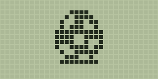<br>Ei | <br>Babytchi | 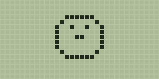<br>Marutchi | 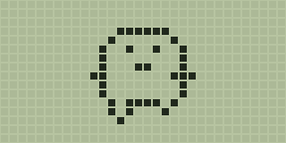<br>Tamatchi |
| 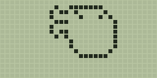<br>Kuchitamatchi | 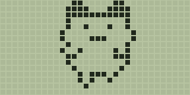<br>Mametchi | 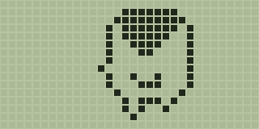<br>Ginjirotchi | 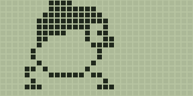<br>Maskutchi |
| <br>Kuchipatchi | 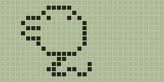<br>Nyorotchi | 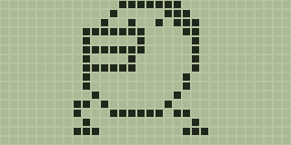<br>Tarakotchi | 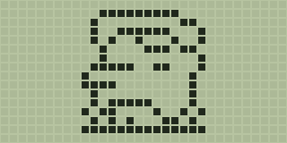<br>Oyajitchi |

## RAM-Adressen

Jede Adresse hält 4 Bit. Alles durch Beobachten und gezieltes Setzen im Emulator ermittelt.

| Adresse | Bedeutung |
|---|---|
| `0x10`/`0x11` | Uhr Sekunden (BCD, niedrig/hoch) |
| `0x12`/`0x13` | Uhr Minuten (BCD, niedrig/hoch) |
| `0x14`/`0x15` | Uhr Stunden (binär, `hoch*16+niedrig`); ein frisches Ei zeigt 32 = nicht gestellt |
| `0x2D` | 8, solange das Ruf-Icon leuchtet |
| `0x40` | Hunger 0–15, Herzen = `(Wert+1)//4`, Mahlzeit +4, fällt in Schritten von 4 |
| `0x41` | Glück 0–15, Herzen = `(Wert+1)//4`, Snack oder gewonnenes Spiel +4 |
| `0x42` | Pflegefehler 0–15 |
| `0x43` | Disziplin-Anzeige, +4 pro Schimpfen bei einem Schimpf-Ruf; bei jeder Verwandlung neu gesetzt |
| `0x46`/`0x47` | Gewicht (BCD) |
| `0x49` | wird 1, wenn das Tier krank war, bei der Verwandlung wieder 0 (nicht weiter geprüft) |
| `0x4B` | Licht: 15 an, 0 aus |
| `0x4D` | Anzahl Häufchen |
| `0x50` | Unterart: 1 Kind; Tamatchi 2 oder 3; Kuchitamatchi 4 oder 5; Erwachsene 15, nur der Maskutchi, der Oyajitchi wird, hat 6 |
| `0x51` | verpasste Schimpf-Rufe 0–15 |
| `0x54` | zählt bei jedem Aufwachen hoch (vermutlich das Alter, nicht geprüft) |
| `0x5D` | Charakter: 0 Ei oder tot, 1 Babytchi, 2 Marutchi, 3 Tamatchi, 4 Kuchitamatchi, 5 Mametchi, 6 Ginjirotchi, 7 Maskutchi, 8 Kuchipatchi, 9 Nyorotchi, 10 Tarakotchi, 11 Oyajitchi |
| `0x84` | im Spiel: ungleich 0, wenn die kommende Runde gewonnen wird (steht vor dem Tastendruck fest) |

## Weitere Beobachtungen

- Im Baby-Alter (65 Minuten) wird nichts gezählt.
- Schimpfen ohne Schimpf-Ruf bewirkt nichts.
- Im Spiel „links oder rechts“ steht das Ergebnis jeder Runde fest, bevor man drückt. Welche
  Taste man wann drückt, ist egal.
- Ein Ei schlüpft erst, nachdem die Uhr gestellt wurde.
- Lebensdauer bei guter Pflege, je ein Lauf im Zeitraffer, in Tagen seit dem Schlüpfen:
  Oyajitchi 24, Mametchi 20, Ginjirotchi 16, Maskutchi 16, Kuchipatchi 8, Tarakotchi 7,
  Nyorotchi 5.

## Aufbau

```
src/tamalib/     TamaLIB mit zwei Korrekturen in cpu.c: i = 0xFF in cpu_step, und die Tasten lösen
                 jetzt wirklich einen Interrupt aus (die Maske landete im falschen Register)
src/tama_core.c  C-Hülle: ROM laden, Ticks laufen lassen, LCD/Ton/RAM auslesen, Zustand sichern
tama.py          ctypes-Anbindung
src/pika_core.c  der Pocket Pikachu: ein eigener Kern für seinen Prozessor (M37520)
pika.py          dessen ctypes-Anbindung, carebot_pikachu.py und growth_pikachu.py Bot und Regeln
src/gb_core.c    ein Game Boy für das Tamagotchi-Spiel: Hülle um Peanut-GB (src/peanut/peanut_gb.h)
gameboy.py       dessen ctypes-Anbindung, carebot_gameboy.py und growth_gameboy.py Bot und Figuren
history.py       der Verlauf: Leben, Figuren und Protokolle in SQLite
carebot.py       der Care-Bot (P1, P2, Angel, Morino)
carebot_umino.py, carebot_mothra.py   die Bots für Umino und Mothra
growth.py        Wachstumsregeln und Planung für ein Ziel (P1, P2)
growth_angel.py, growth_morino.py, growth_umino.py, growth_mothra.py   dasselbe für die anderen
models.py        die bekannten ROMs und worin sie sich unterscheiden
report.py        Tagesbericht per E-Mail
engine.py        ein Tier: Emulator-Schleife und Care-Bot, als eigener Prozess
server.py        HTTP-Server, startet je Tier einen Prozess
web/             Oberfläche, die Unterseite /bot und die Optionen /settings
lab/             die Experimente, aus denen die Tabellen stammen
```

## Lizenz

GPL-2.0, wie TamaLIB (siehe `LICENSE`). Das Spiel-Icon ist „arrow-left-right“ aus
[coolicons](https://github.com/krystonschwarze/coolicons) von Kryston Schwarze (CC BY 4.0). Das
Favicon ist das Icon
[„Tamagotchi“, erstellt von Magnific – Flaticon](https://www.flaticon.com/de/kostenloses-icon/tamagotchi_743850);
es steht unter der Flaticon-Lizenz und nicht unter der GPL. Die Zeichnungen der Geräte in
`web/shells/` stammen aus [BrickEmuPy](https://github.com/azya52/BrickEmuPy) von azya52 (CC0), ebenso
die Vorlage für den Kern des Pocket Pikachu. `src/peanut/peanut_gb.h` ist
[Peanut-GB](https://github.com/deltabeard/Peanut-GB) von Mahyar Koshkouei (MIT, mit Teilen aus
SameBoy von Lior Halphon, ebenfalls MIT; der Lizenztext steht in der Datei).
Tamagotchi ist eine Marke von Bandai, Pikachu und Game Boy sind Marken von Nintendo;
dieses Projekt hat mit Bandai nichts zu tun.
